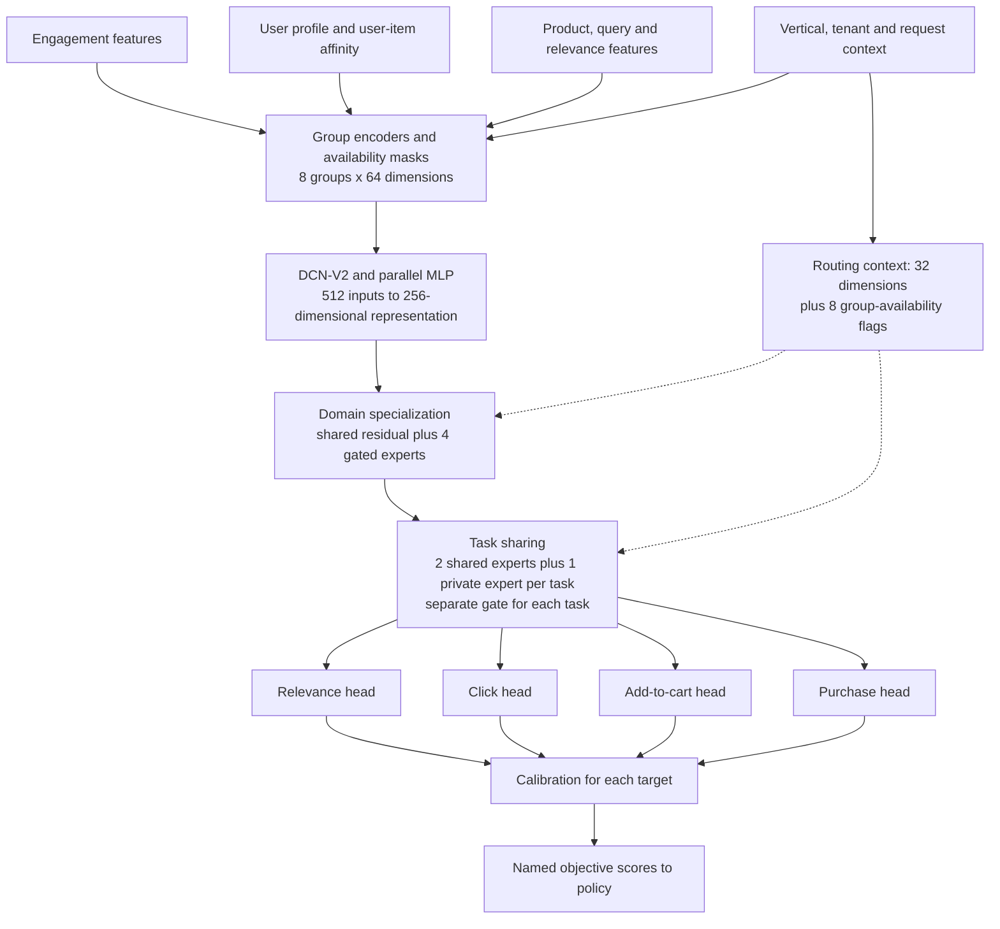

# Synapse ranker: standalone proposal and agent implementation contract

Version 2.0, November 20, 2026. Status: proposed design, ready for local implementation. No models have been trained or benchmarked as part of writing this specification. Architecture dimensions and engineering defaults are hypotheses to evaluate.

**This file is the complete handoff.** A receiving engineer or coding agent must be able to work from this file alone. Prior chat, the original project PDF, private company documentation, and external papers are not required for the core implementation. References provide provenance and further reading; the operational definitions and algorithms in this file are authoritative for this proposed implementation. Diagrams are accompanied by text and pseudocode so a Mermaid renderer is optional.

**Problem and intended outcome.** Walmart needs an L2 ranker, meaning the stage that scores a retrieved candidate set, that can share learning across business tenants, search/ads/personalization surfaces, and product verticals. Mature tenants have rich engagement pipelines; new tenants may initially have only catalog, relevance, and limited user features. Independent models and feature-parity prerequisites slow onboarding and prevent improvements from transferring. The ranker should consume available engagement, user, vertical, catalog, and matching features; learn their interactions; specialize when data supports it; and return interpretable objective predictions to a configurable downstream business policy.

In this document, a tenant is a market or business deployment; a surface is search, ads, or personalization; a vertical is a product department/category; an expert is a trainable subnetwork; and a gate/router produces the mixture weights over experts. CTR means click-through rate, ATC means add-to-cart, and CVR means conversion rate, whose denominator must always be specified. A slate is the final displayed collection/order of products.

**Design constraints carried into this handoff.** The planning workload includes approximately 500 candidates per request. An approximately 5 ms ranker target was proposed in the source project, but the measurement boundary, hardware, and QPS are unknown. Treat that figure as an unverified design target. Product/query/user semantic embeddings may arrive from upstream encoders; building those encoders is outside the initial scope. The core design must operate with aggregate features and optional embeddings. Ordered user actions are an optional extension, never a hidden prerequisite. Final business-weight combination, auctions, and slate/layout optimization remain downstream responsibilities.

**Instructions to an implementing agent.** If this file is provided as an implementation task, execute the local implementation work packages and completion contract below. Inspect the destination repository and applicable repository instructions first. Reuse compatible project infrastructure; if the repository is empty, create the Python package layout specified below. Implement A, B, C, D1 and the controlled experiment harness; default normal training to A/B and keep C/D1 experimental. D2, value prediction, listwise candidate scoring, and production service integration are explicitly deferred. Do not merely return another plan.

Use the specified defaults for reversible local decisions and record deviations. Do not invent production tables, feature semantics, credentials, traffic, hardware, costs, measured gains, or organizational approvals. If real data is absent, finish and verify the synthetic-data path, create the real-data adapter interface and gap report, and label production validation pending. If an external dependency cannot be installed, continue unaffected implementation and record exactly which checks could not execute. Do not present unexecuted commands as passing. This handoff authorizes local code, tests, small fixture runs, and local reports; it does not authorize paid infrastructure, contacting others, online traffic changes, or deployment. Those activities need existing authorization from the receiving task or its environment.

**The receiving agent's required result.** Deliver a reproducible local package, working CLI commands, example configuration and feature registry, deterministic fixture data generator, A/B/C/D1 implementations, checkpoint loading, prediction, calibration, evaluation and benchmark reports, and a concise implementation/decision log. Distinguish `implemented`, `fixture_verified`, `real_data_validated`, and `approved_for_online_test`; each status requires evidence and later statuses are not implied by earlier ones. Preserve this plan beside the implementation and keep decisions in `reports/DECISIONS.md` so the plan remains the design reference.

Build a shared, domain-conditioned, multi-task ranker. Establish a compact reference first, add domain and task experts through controlled experiments, then test a stronger interaction backbone. Add a sequence branch when ordered behavioral events are available.

The scope is the ranker's feature interaction, specialization, scoring, and calibration. Upstream entity embeddings are inputs. Downstream policy receives a vector of named objectives and owns their business combination and slate decisions.

**Four paths use the same feature definitions and prediction targets.**

| Option | Architecture | Choose it when | Main question |
|---|---|---|---|
| A: Compact reference | Group encoders -> DCN-V2 + MLP -> shared representation -> separate heads | Data contracts and serving measurements are still being established | How far do good features and simple joint learning get us? |
| B: Domain and task experts | A's interaction block -> domain residual experts -> shared/private task experts -> heads | Tenants, verticals, or objectives have conflicting feature relationships | Does controlled specialization improve the weaker domains and tasks? |
| C: Scalable feature interaction | Replace B's DCN-V2 + MLP block with RankMixer; preserve the expert blocks and heads | Interaction capacity limits quality and the hardware favors token mixing | Does a stronger feature backbone improve quality at acceptable serving cost? |
| D: Sequence-aware personalization | Add candidate/query-aware history reading to B or C; consider a joint sequence/task backbone later | Ordered item/action/timestamp events are available and fresh | Does detailed history explain preferences beyond existing aggregates? |

B is the reference design to target. Ship A if the extra experts do not earn their cost. C and D answer different questions and can be evaluated separately.

**The reference architecture has three distinct modeling stages.**



Feature crossing learns relationships among inputs. The domain block learns how those relationships vary by context. The task block controls what click, purchase, add-to-cart, and relevance predictions share.

**Use eight initial feature groups, with a versioned schema.**

| Group | Example inputs | Computation scope |
|---|---|---|
| Product engagement | Product CTR/ATC/order rates; impressions and event counts; short/long windows | Per candidate |
| Query-product engagement | Historical query-product interactions, supporting counts, source age | Per query and candidate; absent for some surfaces |
| User profile | Brand/category affinities, price sensitivity, upstream long-term embedding, anonymous flag | Once per request |
| User-product affinity | Prior interactions with this product, category/brand affinity match, reorder features | Per user and candidate |
| Product/catalog | Product embedding, price, discount, attributes, inventory and fulfillment signals | Static projection reusable; live fields refreshed per request |
| Query/relevance | Query embedding or intent, lexical/semantic matching, attribute agreement, retrieval scores | Query projection shared; matching per candidate |
| Vertical/category | Department/category IDs and available vertical-specific numeric features | Per candidate |
| Request/tenant/surface | Tenant, search/ads/personalization surface, device, locale, store/context | Once per request where candidate-independent |

Each group uses its own encoder: numeric/categorical/embedding preparation -> MLP with a 128-unit hidden layer -> 64-dimensional output -> LayerNorm. Embedding lookups and input projections depend on the feature schema; do not allocate one enormous unbounded user/item ID table by default.

For numeric rates, pass supporting counts and freshness as well as the rate. Log-transform counts and skewed magnitudes; fit clipping and normalization using training data. Distinguish a missing value from an observed zero. Upstream model scores remain features with their own provenance and version.

Provide per-feature validity flags to the group encoder. If a whole group is unavailable, use a learned fallback vector and expose the group-availability flag. The base tensor is `[requests, candidates, 8, 64]`; candidate-independent groups can be encoded once and broadcast. The flattened interaction input has width 512. Larger feature groups can be split in later schema versions rather than forced permanently through one narrow vector.

Train with whole-group dropout using plausible missing-feature patterns from target tenants and outages. Tune dropout strength against accuracy on complete inputs and on sparse inputs. Do not independently drop correlated fields in ways the serving system could never produce.

**The interaction block produces a 256-dimensional candidate representation.**

Option A/B starting configuration:

- Two low-rank DCN-V2 cross layers over the 512-dimensional input, rank 32.
- A parallel deep branch, `512 -> 256 -> 128`, with SiLU activations.
- Concatenate the 512-dimensional cross output and 128-dimensional deep output.
- Project `640 -> 256`, followed by LayerNorm and SiLU, to obtain `h_i`.

Examples of useful interactions include user price sensitivity with product price, reorder propensity with grocery category, and query-attribute agreement with historical engagement. These are hypotheses the model can learn; they are not hard-coded rules.

For C, project each of eight group vectors to width 128. Use three dense RankMixer-style blocks, with eight mixing heads and a separate `128 -> 512 -> 128` GELU FFN per token per block. With `X` shaped `[N,8,128]`, the complete block is:

```text
M = X.reshape(N,8,8,16).transpose(1,2).reshape(N,8,128)
S = LayerNorm(X + M)
X = LayerNorm(S + stack_t(FFN_t(S[:,t,:])))
h = SiLU(LayerNorm(Linear_128_to_256(mean_tokens(X))))  # after 3 blocks
```

Token/group positions are fixed. No attention or sparse experts are used inside this initial backbone. This is a small dense instantiation, not a reproduction of the paper's production model. Keep downstream experts, labels, and data fixed for the C comparison. [RankMixer](https://arxiv.org/abs/2507.15551) motivates this block family; [DCN-V2](https://arxiv.org/abs/2008.13535) motivates the A/B cross block.

**Domain experts provide contextual specialization with a shared fallback.**

Construct `d_i`, a 32-dimensional routing-context projection, from tenant, surface, vertical/category, and available request context. Also supply the eight group-availability flags `m_i` to the routers. Vertical-specific continuous features remain in the main input, in addition to the categorical context used for routing.

The proposed domain block is:

```text
4 residual experts D_e: 256 -> 128 -> 256
domain router: concat(h_i[256], d_i[32], m_i[8]) -> 32 -> 4 -> softmax

g_i = domain_router(h_i, d_i, m_i)
r_i = LayerNorm(h_i + sum_e g_i[e] * D_e(h_i))
```

The shared residual path carries general behavior. The four experts can learn contextual variations. They are a common learned bank, not four preassigned businesses or one expert for every tenant/vertical/surface combination. A grocery request and an electronics request can use different mixtures while still sharing parameters.

Start with dense execution: calculate all four small experts, then mix their outputs. Softmax routing does not itself provide sparse-compute savings. Add top-k routing only as a separately measured serving optimization.

Unknown tenants use a shared unknown-tenant embedding and known metadata such as surface, locale, and vertical. Avoid a randomly initialized prediction head for each new tenant. Add tenant-specific residual parameters only if shared conditional modeling fails and sufficient local data exists.

Check expert utilization and per-domain outcomes. If the domain block contributes no useful specialization, remove it; do not force uniform usage when domains have unequal traffic. The separation of common and domain-specialized knowledge is supported by [Pinterest MTMD](https://arxiv.org/abs/2510.09857); this residual topology is our proposed implementation.

**Task experts give each target a controlled path through shared and private knowledge.**

Use one shared/private extraction layer as the initial PLE-style design:

```text
2 shared experts S_1, S_2: each 256 -> 128 -> 128
1 private expert P_k per task: each 256 -> 128 -> 128
4 task routers: each (256 + 32 + 8) -> 32 -> 3 -> softmax

a_i,k = task_router_k(r_i, d_i, m_i)
t_i,k = a_i,k[1] * S_1(r_i)
      + a_i,k[2] * S_2(r_i)
      + a_i,k[3] * P_k(r_i)
```

Each task representation `t_i,k` has width 128. Every task can use both shared experts and its own private expert. The click task cannot directly route through the purchase-private expert. Shared experts are evaluated once per candidate and reused by all task routers. In A, a separate `256 -> 128` projection for each task replaces this expert layer and supplies the same 128-dimensional head interface.

This gives two domain-routing questions and task-routing questions distinct meanings: which contextual residual is useful, and how much task-specific knowledge is needed? The architecture is one extraction layer, not a claim to reproduce the full multi-layer PLE or AdaTT model. A later controlled comparison can substitute AdaTT at this interface. [AdaTT](https://arxiv.org/abs/2304.04959) is a useful reference for adaptive task sharing.

**Start with four named targets and add value prediction when labels support it.**

| Head | Tower | Target definition | Initial loss |
|---|---|---|---|
| Relevance | `128 -> 64 -> 4`, softmax | Exact, substitute, complement, irrelevant, if the judged-label taxonomy supports these classes | Multiclass cross-entropy |
| Click | `128 -> 64 -> 1`, sigmoid | Click on an observed impression within the defined event window | Binary cross-entropy |
| Add-to-cart | `128 -> 64 -> 1`, sigmoid | Attributed add-to-cart per observed impression within the defined window | Binary cross-entropy |
| Purchase | `128 -> 64 -> 1`, sigmoid | Attributed purchase per observed impression within the defined window | Binary cross-entropy |

The relevance taxonomy is a proposal. If the existing judgments are ordinal relevance grades, use their actual schema and an appropriate classifier or ordinal loss. Keep the head's target and version explicit.

The purchase head predicts per-impression purchase probability. A post-click CVR head would be a different target. If an explicit click-to-purchase funnel is adopted, model that dependency and audit direct-cart, view-through, and other purchase paths before enforcing a factorization. [ESMM](https://arxiv.org/abs/1804.07931) provides a reference for click-conditioned conversion modeling.

An optional fifth value task can predict attributed item value conditional on purchase. Its training loss is masked to purchase examples. Expected attributed value per impression is then purchase probability multiplied by conditional expected value, with currency and attribution semantics carried in the schema. Calibrate and evaluate this derived value separately. A price-times-probability proxy should be labeled as a proxy if quantities, discounts, or returns are omitted.

Avoid an undefined generic quality target. Add satisfaction, returns, or negative-feedback heads only with concrete labels, attribution, and delay handling.

**The training plan preserves label meaning and isolates modeling changes.**

For task `k`, use a label-validity mask `a_k` and normalize its loss over valid examples:

```text
L_k = sum_examples(a_k * loss_k) / max(1, sum_examples(a_k))
L_total = sum_k lambda_k * L_k
```

Start with normalized task losses and equal task weights as a tunable reference. Training weights `lambda_k` control optimization; business policy weights control downstream decisions. They are different configurations.

An unjudged product has no relevance label. An unexposed retrieved candidate is not automatically a click negative. An impression whose purchase window has not matured is not a confirmed purchase negative. Account for sampling probabilities if negatives or domains are resampled, and re-evaluate calibration on representative traffic.

Build examples using features available at the original request time. Hold out later time periods and prevent the target event from entering aggregate counts, user history, or upstream teacher features for that example. For engagement learning, log actual exposures and presentation context, and handle position/exposure bias through a justified observation model or propensity method. [Unbiased learning-to-rank](https://arxiv.org/abs/1608.04468) motivates this distinction.

After the pointwise reference is stable, compare an auxiliary ranking objective or teacher distillation. Use valid per-request supervision and recheck probability calibration. A listwise loss is independent of whether the scorer has cross-candidate attention. Pointwise BCE already learns from observed zero-interaction impressions.

Use balanced domain sampling with explicit weights or domain-normalized losses. Report macro averages across tenants/verticals as well as traffic-weighted results. Check label support before interpreting sparse-task changes. Run a held-out-tenant transfer evaluation and progressive feature-removal evaluation before claiming faster onboarding.

**Calibration and output contracts stay stable across options.**

Fit one calibrator per target on a subsequent held-out period. The initial implementation uses global calibration and reports reliability by context; pooled context-aware calibration or tenant offsets are subsequent experiments when support justifies them. Refitting a model or changing training sampling requires checking and potentially refitting calibration. Do not assume an old calibrator remains valid when changing the backbone.

Record whether event probabilities refer to the logged exposure distribution or a defined reference placement. Actual displayed position can inform a bias/calibration model; it must not leak into a score as if the item's future assigned position were already known. Global calibration does not establish causal probabilities under arbitrary policy changes.

The initial response schema contains:

```text
item_id
relevance_class_probabilities and label_schema_version
p_click
p_add_to_cart
p_purchase
optional expected_attributed_value, with currency and attribution definition
model_version, calibration_version, feature_schema_version
feature_coverage and fallback indicators
```

Probabilities specify their attribution window and population in the versioned contract. Policy consumes the objective vector and applies its configured weights and eligibility constraints. Calibration does not turn event probabilities and currency into the same units of utility. [Field-aware calibration](https://arxiv.org/abs/1905.10713) is relevant to checking subgroup reliability.

**D has an incremental implementation and a later architectural alternative.**

For D1, add ordered events without changing the existing eight-group interface:

1. Start with the most recent 50 actions, each carrying item representation, action type, time gap, and applicable surface information. Tune the length against incremental value and data freshness.
2. Project actions to width 128 and use two causal sequence-encoder blocks with four attention heads. All sequence computation sees only past actions.
3. Form a candidate/query-conditioned attention query from product representation, query context, and domain context.
4. Read the encoded history to obtain a 128-dimensional candidate-specific history vector.
5. Project that vector to 64 dimensions and fuse it residually into the user-product-affinity group. B/C then proceeds unchanged.

The history encoder remains candidate-independent, so its states/keys/values can be shared within the request. Candidate-conditioned reads remain per candidate. Persistent cross-request caching additionally requires compatible model versions and update semantics; do not cache candidate-dependent states as universal user state. If events are unavailable, use the existing group fallback and retain the aggregate feature path.

Later, retrieve query- or product-relevant events from longer history and compare them with recent-only history. Evaluate fetch latency as part of this experiment. [Wayfair's query- and candidate-aware search ranking](https://arxiv.org/abs/2611.11675) supports exploring relevant-history selection; the small encoder above is our proposed starting configuration.

For D2, compare a joint sequence/feature or task-aware backbone inspired by [OneTrans](https://arxiv.org/abs/2510.26104) or [MORE](https://arxiv.org/abs/2609.07273). This can replace the explicit interaction/task-sharing machinery and emit task-specific 128-dimensional states to the existing heads. Preserve the semantic prediction contract, not a mandatory single-vector internal representation. Treat this as a separate architectural experiment rather than stacking every proposed module into one model.

**Run the experiments in an order that reveals why quality changes.**

| Run | Change from the common reference | Purpose |
|---|---|---|
| R0 | Existing champion, plus a GBDT reference if useful and affordable | Establish current quality and cost |
| R1 / A | Group encoders + DCN-V2 + shared 256-dimensional representation + independent task towers | Validate features and basic multi-task learning |
| R2 | R1 + shared/private task experts, without domain experts | Isolate task-sharing benefit |
| R3 | R1 + domain residual experts, without task experts | Isolate domain-specialization benefit |
| R4 / B | Both expert stages | Test whether their combination earns its cost |
| R5 / C | B with RankMixer replacing DCN-V2 + MLP | Isolate interaction-backbone benefit |
| R6 / D1 | Strongest cost-qualified aggregate model + candidate-aware history | Isolate incremental history value |

Use a limited common tuning budget for R1-R4, then scale only promising configurations. Keep frozen upstream representations and the training dataset common for the first architecture comparisons. Include a widened dense model as a capacity control before attributing gains solely to experts. Separately ablate group dropout to quantify robustness benefits and any complete-feature quality cost.

Proceed through five work packages:

1. **Data and contract:** feature inventory and coverage by tenant/vertical/surface; impression and label semantics; time-correct joins; initial scoring interface; measured serving budget.
2. **Reference:** R1, held-out calibration, and comparison with R0 on identical eligible candidates. Resolve data and calibration issues before adding routing complexity.
3. **Specialization:** R2/R3/R4, per-task and per-domain results, gate utilization, missing-feature behavior, and cost. Select A, a partial expert design, or B based on evidence.
4. **Capacity or history:** prioritize C when existing inputs seem under-modeled; prioritize D when fresh ordered actions carry information absent from aggregates. Their order depends on available data and hardware.
5. **Serving and online evaluation:** shadow the chosen configuration, verify contracts and feature parity, then run the authorized online experiment against the champion. Expand only after agreed quality and operational gates pass.

**Promotion criteria must cover quality, portability, and serving together.**

Report judged relevance NDCG at the product's display cutoffs; event log loss and PR-AUC; calibration/reliability by task and key slice; cold-user/item performance; held-out-tenant and missing-feature performance; and fallback rate. Track purchase or satisfaction guardrails appropriate to the tested surface. Predefine meaningful improvement and allowed-regression thresholds before looking at experiment outcomes.

Measure end-to-end p50/p95/p99, sustained QPS, memory, and cost per request at representative candidate counts, including approximately 500 candidates. Include feature fetches, embedding reads, queueing, serialization, and cache misses when infrastructure is available. Report separately what a local benchmark excludes. The approximately 5 ms figure remains a target requiring hardware-specific validation; it is not a local completion requirement or an established production SLA.

Run at least one mature tenant and a data-poor transfer setting, with grocery, apparel, and electronics slices where available. A traffic-weighted average can conceal precisely the regressions this framework aims to prevent.

Cross-candidate listwise scoring is a subsequent optional experiment. Keep candidate-context effects distinct from within-candidate feature interactions and from user-history attention. Evaluate a smaller shortlist or teacher distillation before committing the entire candidate set to listwise scoring; coordinate any resulting candidate-set dependency with the downstream slate owner.

The remaining sections make the implementation reproducible without additional context. They distinguish local defaults from production decisions, define the data and API contracts, and specify verification and completion.

**Decision register: proceed locally with defaults; resolve business semantics before production validation.**

| Decision | Local/fixture default | Evidence needed for real-data use |
|---|---|---|
| Task set | Relevance, click, ATC, per-impression purchase | Target owner confirms each event and attribution rule |
| Relevance classes | `[irrelevant, complement, substitute, exact]`, IDs 0-3 | Existing judgment schema and mapping; never silently remap real labels |
| Event windows | Click 1 hour; ATC 24 hours; purchase 7 days | Surface-specific analytics definitions, logging coverage, deduplication and attribution |
| Initial domains | Synthetic `us/mx/new_market`, three product verticals, search/ads/personalization | Authorized pilot tenant/surface list and data coverage report |
| Baseline | A; also compare a supplied champion if available | Champion scores/model and evaluation eligibility definition |
| Routing | Dense 4-expert domain bank; 2 shared + 1 private per task | Evidence from R2-R4 ablations; no assumption that experts must win |
| Embeddings | Optional; fixture query/product/user vectors have width 8 | Actual vector widths, provider/version, refresh and availability timestamps |
| Calibration | Global monotone Platt scaling for binary tasks; scalar temperature for relevance | Representative held-out calibration data; subgroup reliability report |
| Sequence branch | D1 implemented but disabled in A/B/C runs | Past-only ordered events with item/action/time and coverage/freshness statistics |
| Serving | CPU float32 local verification; no external feature fetch | Device, QPS, candidate distribution and end-to-end latency/cost budget |
| Quality promotion thresholds | Unset; local correctness gates below still apply | Team pre-registers numerical improvement, non-inferiority and guardrail margins |

No default in this table represents an existing Walmart contract. Missing production decisions restrict the claims and deployment stage, not progress on local implementation.

**Canonical input: one JSONL record per request, with an ordered candidate array.**

JSONL means one JSON object per line. Support this format first; a production adapter can stream equivalent records from Parquet or another source without changing the model. Timestamps are UTC ISO-8601 strings. Candidate order is an association key, never a feature by itself. A/B/C/D1 score each candidate without looking at the other candidates.

Required request fields are `schema_version`, `request_id`, `request_time`, `request_features`, and `candidates`. Every real candidate needs a unique nonempty `item_id` within its request and a feature map. Training records additionally provide `observation_end`, request-level `event_logging_available` flags, candidate label objects with `label_available_at` timestamps, `exposed`, optional displayed position, and label/feature provenance. An optional request-level `audit_user_id` may support clustered evaluation; it is never an encoded feature. Online records omit training-only fields. Missing logging-availability flags mean unavailable supervision, not confirmed negative outcomes.

This example is illustrative and self-contained; it is not real customer data:

```json
{
  "schema_version": "synapse-input-v1",
  "request_id": "fixture-request-0001",
  "request_time": "2026-01-01T12:00:00Z",
  "observation_end": "2026-01-09T12:00:00Z",
  "event_logging_available": {"click": true, "add_to_cart": true, "purchase": true},
  "request_features": {
    "tenant_id": "us",
    "surface": "search",
    "locale": "en-US",
    "device": "web",
    "anonymous": false,
    "user_price_sensitivity": 0.7,
    "user_embedding": [0.2,0.1,0.0,0.3,0.4,0.0,0.1,0.2],
    "query_embedding": [0.1,0.2,0.0,0.3,0.1,0.4,0.2,0.0]
  },
  "candidates": [{
    "item_id": "fixture-item-0001",
    "features": {
      "product_ctr_7d": 0.08,
      "product_impressions_7d": 1000,
      "query_product_ctr_7d": 0.12,
      "query_product_impressions_7d": 50,
      "user_brand_affinity": 0.6,
      "reorder_probability": 0.2,
      "price": 12.5,
      "in_stock": true,
      "product_embedding": [0.1,0.0,0.2,0.3,0.2,0.1,0.4,0.0],
      "semantic_match": 0.8,
      "attribute_match": 0.9,
      "vertical_id": "grocery",
      "category_id": "pantry"
    },
    "feature_metadata": {
      "product_ctr_7d": {"available_at": "2026-01-01T11:55:00Z", "age_seconds": 300}
    },
    "exposed": true,
    "display_position": 3,
    "labels": {"relevance": 3, "click": 1, "add_to_cart": 0, "purchase": 0},
    "label_available_at": {
      "relevance": "2026-01-01T13:00:00Z",
      "click": "2026-01-01T13:00:00Z",
      "add_to_cart": "2026-01-02T12:00:00Z",
      "purchase": "2026-01-08T12:00:00Z"
    }
  }]
}
```

Feature provenance may live in an adapter-level manifest instead of being repeated for every row. It must document point-in-time availability. If real historical features cannot be reconstructed as of the request, report the gap and do not claim leak-free real-data validation. The single metadata entry above illustrates the representation; it is not evidence for every other field.

Absent keys and JSON null both mean unavailable. An observed numeric zero or boolean false is available. Reject NaN/Infinity, malformed vector lengths, duplicate candidates, future-dated history, and labels outside their declared schema. Unknown categories map to an unknown embedding, not an error. Empty candidate arrays return an empty result without a model forward pass. Pad batches with a separate candidate mask; padding contributes no logits to metrics or loss. Reject malformed required identifiers; do not silently repair associations.

For D1, add request-level `history`, an optional list of `{item_embedding, action_type, event_time, surface}`. Vectors use the declared product-embedding width. Retain only events strictly earlier than the request and take the latest 50; sort by event time with a deterministic tie-break using original event index. Missing history is supported. Future events cause validation failure, not quiet inclusion.

**Feature registry and preprocessing artifacts are part of the model.**

Create `configs/feature_registry.yaml` from this table. The group order is fixed as listed; field order within a group follows registry order. The example fields constitute the minimum fixture registry, not a claim about upstream production field names.

| Group | Request fields | Candidate fields |
|---|---|---|
| product_engagement | none | product_ctr_7d, product_impressions_7d |
| query_product_engagement | none | query_product_ctr_7d, query_product_impressions_7d |
| user_profile | anonymous, user_price_sensitivity, user_embedding | none |
| user_item_affinity | none | user_brand_affinity, reorder_probability |
| catalog | none | price, in_stock, product_embedding |
| query_relevance | query_embedding | semantic_match, attribute_match |
| vertical | none | vertical_id, category_id |
| request_context | tenant_id, surface, locale, device | none |

Every registry entry declares `name`, `group`, `scope` (`request`/`candidate`), `dtype` (`float`/`bool`/`category`/`vector`), transform, optional vector dimension, and optional freshness threshold. In the fixture registry, `anonymous`/`in_stock` are booleans; the three `*_embedding` fields are width-8 vectors; tenant/surface/locale/device/vertical/category fields are categorical; all remaining fields are floats. Counts and price use `log1p`; CTRs and the declared probability/affinity/match features are bounded `[0,1]`; vectors use L2 normalization; categorical and boolean fields use their declared encodings. Freshness thresholds are unset initially. Request-time feature metadata is input; labels, observation end, exposure and displayed position are never ordinary model inputs. Keep immutable tenant/surface IDs separately for auditing even if their model features are dropped.

Fit numeric statistics and category vocabularies on the training partition only. Use `log1p` for counts and price, clamp declared rates to `[0,1]`, clip numeric training values at the 0.1/99.9 percentiles, then standardize with a standard-deviation floor of `1e-6`. Reuse frozen limits and statistics later. Standardized missing numerics are zero with validity 0. Booleans use 0/1 plus a validity flag. L2-normalize present vectors with epsilon `1e-6`; zero-fill absent vectors with validity 0. For every field append availability, `log1p(age_seconds)`, and an age-known flag; unknown age uses zero and age-known 0. An explicitly configured freshness threshold turns an over-age field into unavailable. Do not invent production freshness thresholds.

Use 16-dimensional embeddings for categorical fields in the local reference. Reserve category IDs 0/1/2 for PAD/UNKNOWN/MISSING; learned values start at 3. Cap vocabulary construction at the 50,000 most frequent training values per field; map the rest to UNKNOWN. User/item identifiers associate examples but are not embedding features in the initial registry. Save all mappings and statistics with the checkpoint.

A group's availability is 1 if at least one registered value is available. Encode partial groups with their per-field flags. For a wholly absent group, replace its encoded token with a trainable 64-vector and set its group mask to 0. Keep true missingness distinguishable from unknown categories, for which field availability remains 1.

Whole-group dropout defaults to probability 0.1 per eligible present group during training. Eligible groups initially are product engagement, query-product engagement, user profile, user-item affinity, and query relevance; request context and catalog eligibility metadata remain available. Sample dropout once per request for request-only groups; candidate-dependent groups may use per-candidate masks. Recompute masks after dropout and hide any duplicated dropped information from the routing context. Never let routers read a feature the dropout path claims to have removed. Inference has dropout off. Physical missingness and augmentation masks must be separately observable in training diagnostics.

**Exact local network conventions remove implementation guesswork.**

Let `N` be the number of real candidate examples in the current flattened batch. Each group encoder is `Linear(input_width,128) -> SiLU -> Dropout(0.1) -> Linear(128,64) -> LayerNorm(64)`. The prepared input width is derived from that group's registry, not hard-coded. Start all weights with the framework's standard linear initialization and biases at zero. LayerNorm epsilon is `1e-5`. Set stochastic dropout off for evaluation and inference.

The two low-rank cross layers use this explicit convention, with independent parameters for each layer:

```text
x0 = concatenate_8_group_tokens                 # [N,512]
xl = x0
repeat 2 times:
    v = Linear_512_to_32_without_bias(xl)
    u = Linear_32_to_512_with_bias(v)
    xl = xl + x0 * u                            # elementwise product
deep = Linear_256_to_128(SiLU(Linear_512_to_256(x0)))
h = SiLU(LayerNorm(Linear_640_to_256(concat(xl,deep))))
```

All domain experts apply SiLU between their two linear layers. Shared/private task experts apply SiLU after both linear layers. All routers are `Linear -> SiLU -> Linear -> softmax`. A's independent task projection is `256 -> 128 -> SiLU`. Each head is `128 -> 64 -> SiLU -> output`; training consumes raw logits and uses numerically stable binary/multiclass cross-entropy. Apply sigmoid/softmax only when computing probabilities. Task experts and routers have separate parameters where the architecture declares them private; no accidental module-object reuse.

Routing context shares the existing categorical embedding tables for tenant, surface, vertical, category and locale, concatenates their vectors, and projects them to 32 dimensions with SiLU. Add the eight availability flags to the router input separately. Missing/unknown values use their declared IDs. The domain residual has width 256 and four outputs are mixed by weights summing to one. Each task router mixes exactly three 128-dimensional outputs: two shared, one task-private. No capacity-based token dropping or sparse-routing regularizer is required in the initial design.

For D1, form width-128 action tokens by summing projected item vectors, learned action-type embeddings, learned surface embeddings, and a learned time-gap bucket embedding. Use 16 age buckets with boundaries `[1,5,15,30,60,300,900,1800,3600,21600,86400,259200,604800,2592000,7776000]` seconds and an overflow bucket; bucket index is the count of boundaries less than or equal to the age. Use two pre-LayerNorm causal Transformer blocks, four attention heads, FFN width 512, GELU, and dropout 0.1. For each candidate form one attention query from its projected product vector, request query vector (zero if missing), and routing context. Project that concatenation to width 128, perform four-head attention over history states with padding masked, and project the result to 64 dimensions. For nonempty history, replace affinity token `z` by `LayerNorm(z + history_projection)` and mark it available. For empty history bypass the history branch exactly; never softmax an all-masked sequence. Reuse request-level history states across its candidates. Cross-request cache implementation is deferred.

**Label masks, splits and sampling are executable rules.**

For relevance, a valid label is non-null, belongs to the configured judgment schema, and its `label_available_at` is at or before the applicable observation cutoff, regardless of whether the candidate was exposed. For each binary event task, a label is valid only if all of the following hold: the candidate was exposed, its request's event-logging flag is true, the label is non-null and binary, its `label_available_at` is at or before the cutoff, and the full configured event window ended by that cutoff. Apply the full-window rule to positives and negatives alike to avoid selecting early positives while censoring late negatives. Do not synthesize labels for missing logs. Non-null training labels require availability timestamps; timestamps after a cutoff mask those labels rather than making them available early.

The adapter supplies observed 0/1/null labels using its declared attribution/deduplication policy. This package does not infer causal attribution from a purchase table. The package recomputes validity masks from event windows and observation cutoff. Define the effective observation cutoff as the earlier of record `observation_end` and the split's allowed label cutoff. Future labels must not enter an earlier training or calibration stage.

Partition by request time into disjoint train, validation, calibration and test periods. Local fixture default is oldest 60%, next 15%, next 10%, latest 15% by distinct request times. The train label cutoff is validation start, validation cutoff is calibration start, calibration cutoff is test start, and test cutoff is dataset observation end. Within each partition mask labels whose windows cross that cutoff. Use the validation partition for model/epoch selection, calibration only for calibrator fitting, and test only for final reporting. Keep every candidate in a request in the same partition. Real-data split boundaries are explicit configuration and recorded in the manifest.

Start with natural sampling, no negative downsampling, and normalized task losses with weights 1.0. Skip tasks with zero valid labels in a batch; if all tasks lack labels, skip the optimizer step. This case must not create NaN or a fictitious supervised update. If domain-balanced sampling is enabled later, record selection probabilities, cap amplification of very small domains, apply documented importance weighting where the target is the natural population, and retain an untouched naturally sampled evaluation set. Position-bias correction and randomized exposure data need an explicit integration; record their absence as a real-data limitation rather than labeling naive estimates unbiased.

**Reference configuration to materialize as `configs/reference.yaml`.** The fixture generator and all CLI commands below use this exact key vocabulary; validate unknown keys and inconsistent dimensions at startup.

```yaml
spec_version: synapse-ranker-v2
seed: 17
data:
  format: jsonl
  input_schema: synapse-input-v1
  registry: configs/feature_registry.yaml
  fixture_requests: 512
  fixture_max_candidates: 8
  fixture_embedding_dim: 8
  split_fractions: [0.60, 0.15, 0.10, 0.15]
  event_windows_seconds:
    click: 3600
    add_to_cart: 86400
    purchase: 604800
model:
  option: B
  base_option: B
  domain_enabled: true
  task_experts_enabled: true
  group_dim: 64
  representation_dim: 256
  task_dim: 128
  dropout: 0.1
  group_dropout_probability: 0.1
  cross_layers: 2
  cross_rank: 32
  domain_experts: 4
  shared_task_experts: 2
  private_task_experts: 1
  mixer_layers: 3
  mixer_dim: 128
  mixer_heads: 8
  sequence_enabled: false
  sequence_max_actions: 50
  sequence_layers: 2
  sequence_dim: 128
  sequence_heads: 4
tasks:
  target_schema_version: fixture-targets-v1
  relevance_classes: [irrelevant, complement, substitute, exact]
  relevance_gains: [0, 1, 3, 7]
  loss_weights:
    relevance: 1.0
    click: 1.0
    add_to_cart: 1.0
    purchase: 1.0
training:
  device: cpu
  precision: float32
  batch_requests: 8
  learning_rate: 0.001
  optimizer: adamw
  weight_decay: 0.00001
  gradient_clip_norm: 1.0
  epochs: 3
  max_steps: 2000
  early_stopping_patience: 2
calibration:
  binary_method: monotone_platt
  relevance_method: temperature
  min_examples: 200
  min_positive: 20
  min_negative: 20
evaluation:
  ndcg_cutoffs: [5, 10, 20]
  reliability_bins: 10
  bootstrap_samples: 500
  bootstrap_unit: user_if_available_else_request
benchmark:
  candidate_counts: [1, 8, 32]
  warmup_iterations: 20
  timed_iterations: 200
  include_preprocessing: true
  include_external_feature_fetch: false
```

Default optimizer betas are `(0.9,0.999)`. For smoke runs, override `max_steps` to 30. Keep hidden widths fixed for the first ablations; tune only after correctness and shared-data comparisons. A forces both expert stages off. B uses the two expert-enable flags, normally both true. R2 is B with domain disabled; R3 is B with task experts disabled. C substitutes the defined mixer backbone and uses the same flags as B. D1 uses `base_option` B/C and forces the sequence branch on. A/B/C force it off. Record the fully resolved configuration after option/CLI overrides. Never infer the option from the number of available features.

**Calibration and inference have explicit failure/fallback behavior.**

For binary logits `z`, fit `sigmoid(exp(a) * z + b)` using held-out log loss, initialized with `a=b=0`; the positive slope preserves within-head ordering. For relevance fit scalar positive temperature `T=exp(t)` on multiclass cross-entropy, initialized with `t=0`. Use a bounded, deterministic optimizer with maximum 100 iterations and record convergence. If support is below the configured example/positive/negative minimum, use identity and report `identity_insufficient_data`; do not claim that calibration was achieved. Relevance temperature requires at least two observed classes. Tenant offsets and richer field-aware calibration are deferred until the global reference is validated.

Each checkpoint records which tasks actually had supervised updates, counts by label/class, and supported status. A task with no supervised training or insufficient class variation is `unsupported`. Return null objective values for unsupported tasks, even though internal forward logits are finite. For supported but uncalibrated tasks, return the probability with an explicit calibration status. An unsupported output must not silently enter a downstream business-weight combination.

The prediction response echoes request/item IDs and input candidate order. Include `schema_version`, per-head probabilities, per-head support/calibration status, model/schema/preprocessor/calibrator versions, feature-coverage flags, and fallback indicators. Example shape:

```json
{
  "schema_version": "synapse-output-v1",
  "target_schema_version": "fixture-targets-v1",
  "request_id": "fixture-request-0001",
  "model_version": "content-hash-or-run-id",
  "feature_schema_version": "registry-content-hash",
  "preprocessor_version": "preprocessor-content-hash",
  "calibration_version": "calibrator-content-hash-or-identity",
  "items": [{
    "item_id": "fixture-item-0001",
    "relevance_class_probabilities": [0.05,0.05,0.20,0.70],
    "p_click": 0.12,
    "p_add_to_cart": 0.04,
    "p_purchase": 0.02,
    "head_status": {
      "relevance": "trained",
      "click": "trained",
      "add_to_cart": "trained",
      "purchase": "trained"
    },
    "calibration_status": {
      "relevance": "identity_insufficient_data",
      "click": "fitted_global",
      "add_to_cart": "identity_insufficient_data",
      "purchase": "identity_insufficient_data"
    },
    "feature_group_available": [1,1,1,1,1,1,1,1],
    "used_unknown_tenant": false,
    "used_history": false
  }]
}
```

These numbers illustrate shape only. Reject incompatible registry/embedding dimensions and checkpoint/preprocessor versions at load time. Never silently refit preprocessing during prediction. Pack config, model weights, training-support metadata, preprocessor, calibrator, and manifest together. Use state dictionaries plus JSON/YAML metadata; loading an untrusted executable serialized model is not part of this interface.

**Repository deliverables and command interface.** Use Python 3.11 or newer with PyTorch, NumPy, PyYAML, scikit-learn and pytest, adapting to compatible existing repository dependencies. Keep CPU execution sufficient for all fixture verification. Create a `pyproject.toml` and resolve/record the actual tested versions in a lockfile or environment manifest; no dependency versions are asserted current by this document. Do not require cloud services, a feature store, online credentials, a GPU, or downloaded foundation-model weights for local completion.

```text
pyproject.toml
README.md
RANKER_ARCHITECTURE_PLAN.md
configs/
  reference.yaml
  feature_registry.yaml
src/synapse_ranker/
  __init__.py
  __main__.py
  config.py
  contracts.py
  preprocessing.py
  data.py
  fixtures.py
  models/{encoders,interactions,experts,sequence,ranker}.py
  losses.py
  training.py
  calibration.py
  evaluation.py
  inference.py
  benchmark.py
tests/
reports/
  IMPLEMENTATION_REPORT.md
  DATA_GAPS.md
  DECISIONS.md
```

The directory names are the default layout, not a reason to disrupt an existing compatible project. Separate pure model math from data access and CLI orchestration. Use a simple adapter protocol `iter_requests(path, registry) -> validated request records`; the canonical JSONL adapter is mandatory, proprietary source adapters are integration work.

Define these internal interfaces, with equivalent typed structures if the project already has conventions:

```text
prepare_batch(records, frozen_preprocessor)
  -> prepared feature tensors, candidate_mask, group_mask, routing categories,
     label tensors, task-validity masks, request/item associations, optional history

model.forward(batch)
  -> raw relevance/event logits and optional routing diagnostics

compute_loss(outputs, labels, valid_masks, weights)
  -> scalar loss or skip indicator, valid counts, per-task losses

predict(request_records, model_bundle)
  -> synapse-output-v1 responses; no labels or observation_end required
```

Implement the following user-facing commands. Paths beneath `artifacts/` are generated outputs and excluded from source control. Each command exits nonzero on invalid contracts or failed required checks and writes a machine-readable manifest with run/config/version identifiers.

```bash
python -m pip install -e '.[dev]'
python -m synapse_ranker make-fixture --config configs/reference.yaml --out artifacts/fixture.jsonl
python -m synapse_ranker validate-data --config configs/reference.yaml --data artifacts/fixture.jsonl --out artifacts/validation
python -m synapse_ranker train --config configs/reference.yaml --option A --data artifacts/fixture.jsonl --out artifacts/A --max-steps 30
python -m synapse_ranker train --config configs/reference.yaml --option B --data artifacts/fixture.jsonl --out artifacts/B --max-steps 30
python -m synapse_ranker calibrate --run artifacts/B --data artifacts/fixture.jsonl --split calibration
python -m synapse_ranker evaluate --run artifacts/B --data artifacts/fixture.jsonl --split test --out artifacts/B/evaluation
python -m synapse_ranker predict --run artifacts/B --input artifacts/fixture.jsonl --out artifacts/B/predictions.jsonl
python -m synapse_ranker benchmark --run artifacts/B --out artifacts/B/benchmark.json
python -m synapse_ranker experiment --config configs/reference.yaml --data artifacts/fixture.jsonl --runs R1,R2,R3,R4 --max-steps 30 --out artifacts/ablations
python -m synapse_ranker train --config configs/reference.yaml --option C --data artifacts/fixture.jsonl --out artifacts/C --max-steps 30
python -m synapse_ranker train --config configs/reference.yaml --option D1 --base-option B --data artifacts/fixture.jsonl --out artifacts/D1 --max-steps 30
python -m pytest -q
```

`train` creates the time partitions and frozen preprocessor from its training period, selects checkpoints using validation only, and saves the partition manifest for all later commands. Use the weighted mean validation loss over supported tasks as the initial checkpoint-selection metric; report task losses separately. If validation has no usable labels, save the final checkpoint with `selection_unvalidated` and disable metric-based early stopping; never use test data as a substitute. `calibrate` updates the bundle atomically and records prior/new calibration versions. `evaluate` may not retrain or refit. `predict` ignores training-only fields if present; its tests also use records with those fields entirely removed. `experiment` changes only the specified ablation switches and uses shared partitions/preprocessing for comparisons. `benchmark` constructs synthetic inputs matching the frozen registry by default and accepts an optional authorized input file; report which was used. CLI help must document every override and output path.

**The fixture demonstrates mechanics, never Walmart model quality.** Generate 512 requests spread over 120 simulated days with 1-8 candidates, three synthetic tenants including an unseen tenant held out from training, three verticals, and the three surfaces. Keep request timestamps and IDs deterministic for seed 17. Include past-only histories, complete and missing engagement groups, anonymous users, unknown categories, unexposed judged candidates, unavailable labels, and immature event windows. Generate labels from documented synthetic feature interactions and seeded randomness after the features are constructed; label fields must never be model inputs. Include positive/negative examples and several relevance classes where partition support allows. Tiny calibration slices may legitimately use identity fallback.

Place some mature-tail requests after the training cutoff in the unseen tenant to exercise unknown-tenant behavior. Keep a separately flagged transfer slice rather than reporting its metrics as in-domain quality. Do not hand-tune labels to make B/C/D1 beat A, do not use the fixture to choose architecture, and do not extrapolate fixture latency or quality to production. Tiny-dataset overfitting is allowed only in an isolated test that proves gradient flow.

**Verification must test meaningful contracts and failure cases.**

| Verification | Required evidence |
|---|---|
| Model paths | A/B/C/D1 produce finite correctly shaped logits and gradients on CPU |
| Masking | Missing labels, unexposed event examples, immature windows and padded candidates have zero loss contribution; all-masked batches skip safely |
| Leakage protection | Split artifacts fit preprocessing on training only; future feature/history timestamps are rejected; label cutoffs are enforced |
| Associations | Candidate permutation permutes outputs identically in evaluation mode; changing another candidate does not change an item's A/B/C/D1 score |
| Missing features | Partial/entire missing groups and unknown tenant/category values remain finite; missing and zero have distinct encodings |
| Routing | Weights sum to one; each task can access only its two shared and own private expert; gradients reach intended parameters |
| Sequence behavior | Empty-history D1 exactly matches its B/C base when common weights are copied in evaluation mode; causal/padding masks exclude future/padded actions |
| Persistence | Save/load predictions agree within `atol=1e-6, rtol=1e-5` in CPU float32; incompatible registry/version fails clearly |
| Calibration | Binary mapping is monotone; low-support calibration falls back with status; unsupported heads return null |
| Inference boundary | Prediction works after removing labels, label_available_at, event_logging_available, exposure, display position, observation_end and training-only metadata |
| End-to-end path | Fixture generation -> validation -> short training -> calibration -> test evaluation -> prediction -> benchmark completes with manifests |

These are core implementation tests, not a requirement to add a test for every trivial helper. Include a deterministic tiny-data optimization test demonstrating meaningful loss reduction with sufficient iterations; do not require a particular synthetic ranking lift or force every head to improve at every step. State any nondeterminism and device-specific tolerances.

**Evaluation report contract and promotion gates.** Write `metrics.json`, per-slice `slices.csv`, reliability-bin data and a short Markdown interpretation. Every metric includes valid sample/request counts and label support. Undefined metrics, including PR-AUC on a single-class slice or NDCG with no positive gain, are null with a reason. Report unsupported tasks explicitly.

Compute judged NDCG with configured gains/cutoffs on candidates with valid human/fixture judgments; identify it as `ndcg_judged` and report judgment coverage because unjudged items are excluded. Compute event log loss, PR-AUC, ROC-AUC where defined, Brier score, reliability bins, and predicted/observed event totals on valid exposed examples. Logged-event ranking metrics are diagnostics under the logged exposure policy, not unbiased relevance truth. Report each task independently; do not invent production business weights to create a combined primary score.

Slice by tenant, surface, vertical, anonymous/known user, complete/missing engagement, and seen/unseen tenant. Include traffic-weighted and equal-domain summaries where support exists. For real-data comparisons, bootstrap paired differences using user clusters when a valid user key exists, otherwise requests; state that limitation and the 95% interval method. Hold features, eligible candidates and label validity constant across alternatives. Confidence intervals and tiny-fixture results do not substitute for pre-registered business margins or online validation.

The local correctness gate is all required contract tests and end-to-end fixture commands passing, with honest manifests and limitations. The real-data gate additionally requires approved semantics, leak-free historical joins, representative coverage, comparison against R0/A, calibrated/sliced results, and the team's predeclared numerical margins. The serving gate requires measured hardware/QPS/latency and cost budgets. The online gate additionally requires the appropriate traffic-change authorization and an experiment/rollback owner. No model is promoted just because a more complex option exists.

The local benchmark records device/CPU/GPU, memory, software versions, model option, candidate counts, thread counts, warmup/timed iterations, preprocessing scope, cache assumptions and batch/microbatch settings. Synchronize GPU work around timing if a GPU is used. Report model-only and local preprocessing-plus-model latency separately. The default 200 repetitions are a smoke measurement; a production p99/load claim requires enough repetitions and representative concurrency/load. External feature-fetch latency and sustained service QPS are `not_measured` when no production adapter/service is present; never enter zeros for missing measurements. Candidate counts 100/250/500 are a follow-up benchmark once local runs succeed, subject to the supplied hardware budget.

**Work packages, handoff evidence, and stop conditions.**

| Package | Build/produce | Done when |
|---|---|---|
| W0: Inventory | Inspect repository; materialize config/registry; decision and data-gap logs | Existing conventions retained; defaults and unknown production inputs recorded |
| W1: Data | Canonical adapter, validators, time splits, preprocessing, masks, fixture generator | Data/leakage/masking tests and validation manifest pass |
| W2: Reference | A and B, loss, training, persistence, CLI | Both short-train; correct head support and save/load evidence exist |
| W3: Comparisons | R1-R4 runner, C backbone, D1 branch | Shared-data ablations run locally; C/D1 forward/backward and short runs pass |
| W4: Scoring | Calibrators, inference, evaluation, benchmark | Full fixture command sequence completes; reports identify scope and unsupported metrics |
| W5: Team review | README quickstart, implementation report, resolved decisions and remaining integration gaps | A new engineer can reproduce the local workflow from a fresh compatible environment |
| W6: Integration, conditional | Real-data adapter, approved evaluation, representative serving measurement | Only after required data/contracts/resources are supplied; otherwise pending with exact next actions |

Default execution scope is W0-W5. Continue into W6 only where the receiving task supplies the required authorized inputs; do not create a production dependency just to finish a local task. Use the existing codebase's interfaces when present, but document equivalent command names and any deliberate schema deviations. Work sequentially unless the receiving task or applicable repository instructions authorize agent delegation.

`reports/IMPLEMENTATION_REPORT.md` must list implemented options/modules; exact commands and outcomes; fixture identity and split manifest; checkpoint/schema versions; actual measured local metrics/timings with scope; unexecuted checks and causes; known limitations; and recommended next experiment based on available evidence. `DATA_GAPS.md` lists each missing production input, affected claims/work packages, expected interface, and concrete next action. `DECISIONS.md` records date, decision, default/override, rationale, and evidence. Do not mark the entire initiative production-ready when only fixture verification is complete.

If production data is unavailable, the final handoff must still include working W0-W5 deliverables, the output of the fixture workflow, and a precise adapter/semantics checklist. If code or dependency execution is blocked, provide the completed unaffected files and an explicit verification status; leave no fabricated success or silent TODO in a required path. Experimental D2 and other deferred work may be documented as future work without stubbing it into the completed core.

**Standalone instruction for the next agent.** The team can supply this file with: "Implement this specification in the current repository. Complete W0-W5 using the stated defaults and synthetic fixtures when real data is absent. Preserve existing repository conventions, run the required verification, and report evidence and remaining production integration gaps. Implement the specified options; keep optional research and traffic changes outside the default scope." No previous conversation or PDF is needed to interpret that instruction.

**Provenance and optional reading.** Project context was supplied as *Project Synapse: An Experimentation Framework for Next-Gen Ranking at Walmart*, a two-page PDF provided by the requester. All source-project context needed for this ranker handoff is restated above; the PDF is not a required input and there are no machine-specific links. The proposed composition and small-model configurations here are engineering choices, not claims that a published paper establishes Walmart-specific gains or latency. Optional primary references:

- [DCN-V2: feature crossing](https://arxiv.org/abs/2008.13535).
- [RankMixer: token mixing and per-token feed-forward networks](https://arxiv.org/abs/2507.15551).
- [AdaTT: adaptive multi-task sharing](https://arxiv.org/abs/2304.04959).
- [MTMD: shared and specialized multi-domain ranking](https://arxiv.org/abs/2510.09857).
- [ESMM: click-conditioned conversion modeling](https://arxiv.org/abs/1804.07931).
- [Field-aware calibration](https://arxiv.org/abs/1905.10713).
- [Unbiased learning-to-rank with biased feedback](https://arxiv.org/abs/1608.04468).
- [Query- and candidate-aware history for sponsored-product search](https://arxiv.org/abs/2611.11675).
- [OneTrans: joint sequence and feature modeling, deferred alternative](https://arxiv.org/abs/2510.26104).
- [MORE: task-aware unified backbone, deferred alternative](https://arxiv.org/abs/2609.07273).
